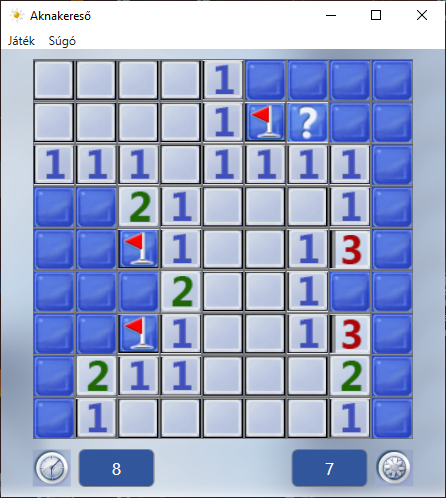
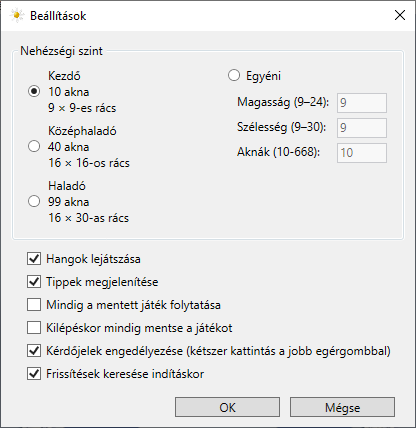
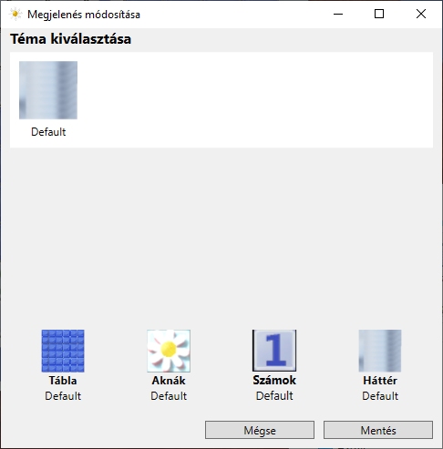
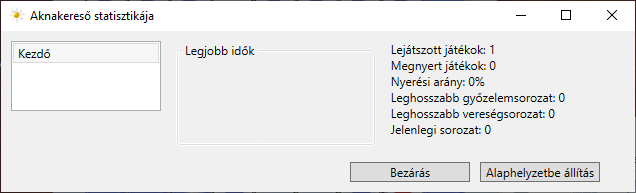

# Minesweeper-WPF

> [!NOTE]
> A projekt további fejlesztése lezárult. A játék mechanikája UI nélkül a [MinesweeperCore](https://github.com/vgeri108/MinesweeperCore) projektben készül el. Az új program felhasználói felülettel elkészült és elérhető a [MinesweeperReborn](https://github.com/vgeri108/MinesweeperReborn) repositoryban.

## Bevezető
Az aknakereső egy logikai játék, amelyben a számok azt mutatják meg, hogy az adott mező körüli szomszédos mezőkön hány akna található. A cél az összes aknamentes mező felfedése.\
A program megjelenése a Windows 7 beépített aknakereső játékára alapul.

## Képernyőképek

